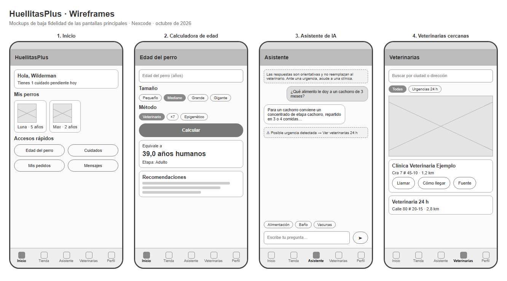

# HuellitasPlus · Mockups

Wireframes de baja fidelidad de las cuatro pantallas principales. Muestran la distribución de los elementos y la navegación, no los colores ni la tipografía finales (Material 3 con la fuente Nunito). El archivo `mockups/wireframes.html` es editable y se abre en cualquier navegador.

| # | Pantalla | Elementos principales | Requisitos |
|---|---|---|---|
| 1 | Inicio | Saludo con cuidados pendientes, tarjetas de los perros y accesos rápidos | RF-05, RF-06 |
| 2 | Calculadora de edad | Edad, tamaño, método de cálculo, resultado en años humanos, etapa de vida y recomendaciones | RF-01, RF-02 |
| 3 | Asistente de IA | Aviso legal fijo, burbujas de conversación, alerta de urgencia, sugerencias y campo de pregunta | RF-07, RF-08 |
| 4 | Veterinarias | Buscador por ciudad, filtro de urgencias 24 h, mapa y tarjetas con distancia, llamar, cómo llegar y fuente | RF-09 |

**Navegación:** barra inferior con cinco módulos (Inicio, Tienda, Asistente, Veterinarias y Perfil); la calculadora se abre desde los accesos rápidos de Inicio.

**Criterios de diseño:**
- **El aviso legal del asistente está siempre visible** y la alerta de urgencia lleva directo al mapa.
- **Las veterinarias muestran su fuente pública** (OpenStreetMap) para que el usuario pueda verificarlas.
- **Imágenes con descripción** (`contentDescription`) para lectores de pantalla.
