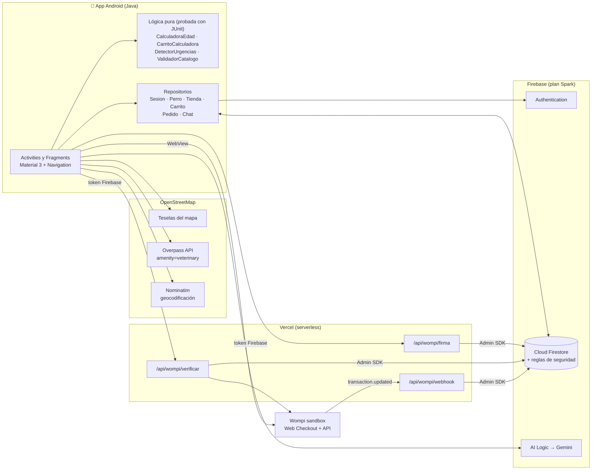
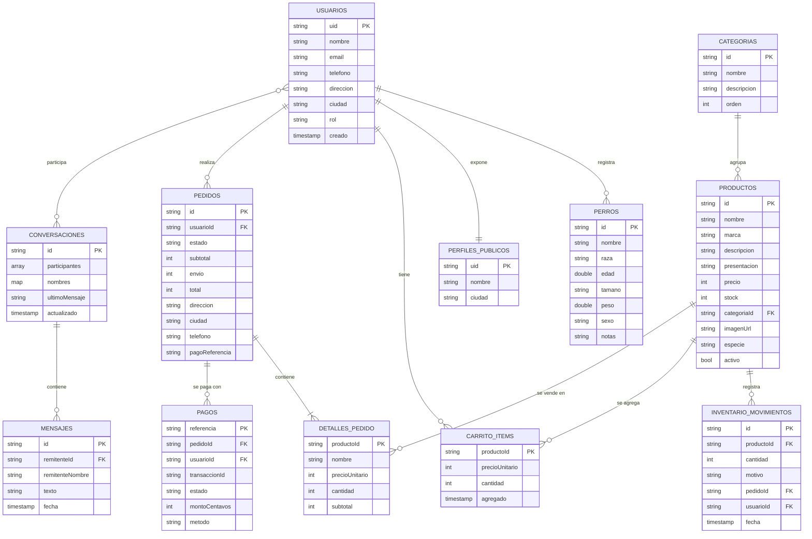

# HuellitasPlus — Documento técnico

**Actualización de la aplicación "La edad del perro vs. la del hombre"**
Guía Taller II · Corte III · Optativa II – Desarrollo de Aplicaciones para Dispositivos Móviles
Universidad de San Buenaventura · Docente: Ing. Jairo Armando Salcedo Aranda
Autores: Jeferson Wilderman González Tenjo · José Leandro Ocampo Camacho — **Nexcode Corporation**

---

## 1. Descripción de la solución

HuellitasPlus convierte la calculadora de edad canina de la Guía I en una **plataforma de servicios
para perros**. Conserva el cálculo original (método veterinario, ×7 y fórmula epigenética 2020) y
agrega estos módulos:

| # | Módulo | Qué permite |
|---|---|---|
| 1 | Edad del perro | Calculadora rediseñada, registro de perros, equivalencia y recomendaciones por etapa de vida |
| 2 | Identidad visual | Marca, logo, ícono adaptativo, splash del sistema e intro animada en video |
| 3 | Cuenta | Registro, inicio y cierre de sesión, recuperación de contraseña y edición del perfil |
| 4 | Asistente IA | Chat con Gemini sobre cuidado canino, detección de urgencias y aviso legal |
| 5 | Veterinarias | Mapa de veterinarias reales y urgencias 24 h, búsqueda por ciudad, llamar y cómo llegar |
| 6 | Tienda | Catálogo de alimentos para perros con buscador, filtros, inventario y panel de administración |
| 7 | Carrito | Cantidades, subtotales, envío, dirección de entrega, confirmación e historial |
| 8 | Pagos | Wompi sandbox con estados aprobado, rechazado y pendiente, y comprobante en PDF |
| 9 | Mensajes | Chat en tiempo real entre usuarios registrados, independiente de la IA |

**Restricción de diseño:** todo el stack usa **servicios gratuitos sin tarjeta de crédito**.

---

## 2. Tecnologías y justificación

| Necesidad | Tecnología | Por qué se eligió |
|---|---|---|
| App | **Android nativo en Java**, XML, View Binding, Material 3, Navigation Component | Continúa el proyecto de la Guía I (Java), como exige la guía |
| Autenticación | **Firebase Authentication** (correo y contraseña) | Gratis; las contraseñas nunca pasan por nuestra base de datos |
| Base de datos | **Cloud Firestore** | NoSQL en tiempo real (chat y estados de pago), caché sin conexión y reglas de seguridad declarativas; plan Spark gratuito |
| IA | **Gemini** vía **Firebase AI Logic** | Nivel gratuito y la API key no va dentro del APK; las peticiones salen del proyecto de Firebase |
| Mapas | **OpenStreetMap**: osmdroid (mapa), **Overpass API** (veterinarias), **Nominatim** (direcciones y respaldo de veterinarias) | Gratis, sin API key ni facturación. Cada veterinaria es un lugar real con su ficha pública verificable en openstreetmap.org |
| Pagos | **Wompi** (Bancolombia) en **sandbox** | Ver la sección 2.1 |
| Backend de pagos | **Vercel** (funciones serverless Node.js, plan Hobby) | Guarda los secretos de Wompi fuera de la app y recibe el webhook. Firebase Cloud Functions exige el plan de pago Blaze |
| Imágenes | Glide; fotos de **Open Pet Food Facts** (CC BY-SA) | Imágenes reales por código de barras sin pagar almacenamiento (Firebase Storage también exige Blaze) |
| HTTP | OkHttp | Cliente estándar para Overpass, Nominatim y el backend |
| PDF | `android.graphics.pdf.PdfDocument` | API nativa; no requiere librerías |

### 2.1 Justificación de la pasarela de pago (Wompi)

Se evaluaron Wompi, Mercado Pago y PayU:

| Criterio | Wompi | Mercado Pago | PayU |
|---|---|---|---|
| Sandbox gratis e inmediato | Sí, al registrarse | Requiere crear usuarios de prueba vendedor y comprador | Sí, con credenciales públicas de prueba |
| Métodos colombianos | Tarjeta, PSE, Nequi, Bancolombia, Daviplata | Tarjeta, PSE, Efecty | Tarjeta, PSE, Efecty |
| Integración desde Android | Web Checkout: una URL firmada, sin SDK | Checkout Pro: requiere crear una "preferencia" en el servidor | WebCheckout con formulario POST y firma MD5/SHA |
| Seguridad | Firma de integridad SHA-256 y eventos con checksum SHA-256 | Webhooks con firma | Firma MD5 o SHA |
| Datos de prueba por estado | Aprobado, rechazado y **pendiente** documentados | Sí | Sí |

**Decisión: Wompi.** Es colombiana y ofrece los métodos de pago locales. La integración es la más
simple: una URL firmada y un webhook. Su sandbox permite reproducir los tres estados que pide la
guía. Además, la firma SHA-256 obliga a calcular el monto en el servidor, así el precio no se puede
alterar desde la app.

---

## 3. Arquitectura



### 3.1 Integración del servicio de IA

1. `AsistenteViewModel` crea un `AsistenteIA` con **instrucciones de sistema**: rol de asistente
   canino, idioma español, temas permitidos, prohibición de diagnósticos y dosis, y un **protocolo
   de urgencias**. Las instrucciones incluyen los perros registrados del usuario para personalizar
   las respuestas.
2. Cada pregunta se envía con `ChatFutures.sendMessage()` del SDK `firebase-ai`, que conserva el
   historial de la conversación. La llamada sale autenticada desde el proyecto de Firebase, así que
   no hay API key en el código.
3. **Detección de urgencias en dos capas:**
   - *Capa local:* `DetectorUrgencias` busca expresiones regulares (intoxicación, convulsiones,
     dificultad respiratoria, sangrado, trauma, torsión gástrica, golpe de calor, etc.). Funciona
     sin conexión y antes de que el modelo responda.
   - *Capa del modelo:* las instrucciones obligan a Gemini a iniciar su respuesta con `[URGENCIA]`
     cuando detecta una emergencia. La app retira la etiqueta antes de mostrar el texto.
   - Con cualquiera de las dos capas aparece un **banner rojo** que recomienda atención inmediata.
     El banner tiene un botón que abre el mapa filtrado por **urgencias 24 h**.
4. Un aviso fijo informa que la IA **no sustituye** al médico veterinario. La barra superior tiene
   siempre un acceso a urgencias.

### 3.2 Integración del servicio de mapas

1. Se pide el permiso de ubicación en tiempo de ejecución y se obtiene la posición con
   `FusedLocationProviderClient`.
2. Se consulta **Overpass** con `amenity=veterinary` en un radio de 5 km. Si no hay resultados, el
   radio se amplía a 15 km. Si Overpass no responde en 10 s (sus servidores públicos suelen estar
   saturados), se usa como respaldo **Nominatim**, que devuelve los mismos lugares
   `amenity=veterinary` de OSM con sus etiquetas (teléfono, horario, urgencias).
3. Por cada lugar se muestra el nombre, el teléfono, la dirección y el horario registrados en OSM,
   junto con la distancia calculada con la fórmula de Haversine.
4. **Urgencias:** una veterinaria se marca como "URGENCIAS 24 H" **solo** si OSM tiene
   `emergency=yes` u `opening_hours=24/7`, es decir, información verificada. No se infiere de ningún
   otro dato.
5. Si el usuario no autoriza la ubicación, puede **buscar por ciudad o dirección** con Nominatim.
6. Acciones de cada veterinaria:
   - **Llamar:** abre el marcador con el número.
   - **Cómo llegar:** abre Google Maps o la app de mapas instalada.
   - **Fuente:** abre la ficha pública del lugar en openstreetmap.org, que es la prueba de que la
     dirección es real.
7. **Ver en Google Maps:** complemento para lugares que aún no están en OSM. Abre la app de Google
   Maps buscando «veterinaria» en la misma zona. Es un enlace, no la API de Google, así que no requiere
   clave ni facturación; el mapa y la lista propios siguen siendo solo de OSM.

### 3.3 Flujo de compra y pago

```mermaid
sequenceDiagram
    actor U as Usuario
    participant App
    participant FS as Firestore
    participant V as Vercel
    participant W as Wompi

    U->>App: Confirmar pedido
    App->>FS: Transacción: relee precio y stock, crea pedido + detalles,<br/>descuenta inventario y vacía el carrito
    U->>App: Pagar con Wompi
    App->>V: POST /firma (token Firebase, pedidoId)
    V->>FS: Valida dueño, estado y total con precios actuales
    V-->>App: URL del checkout firmada (SHA-256)
    App->>W: Abre el Web Checkout (WebView)
    U->>W: Paga con datos de prueba
    W-->>App: Redirige a /retorno?id=transacción
    App->>V: POST /verificar
    V->>W: GET /transactions/{id}
    V->>FS: Actualiza pago y pedido (PAGADO / PAGO_RECHAZADO / PAGO_EN_PROCESO)
    W->>V: Webhook transaction.updated (checksum)
    V->>FS: Confirma el estado final; si es rechazado, devuelve el inventario
    FS-->>App: Escucha en tiempo real → pantalla y comprobante PDF
```

---

## 4. Modelo de datos (Cloud Firestore)



| Entidad (guía) | Ruta en Firestore |
|---|---|
| Usuarios | `usuarios/{uid}` (privado) + `perfiles_publicos/{uid}` (nombre y ciudad) |
| Perros registrados | `usuarios/{uid}/perros/{id}` |
| Productos | `productos/{id}` |
| Categorías de alimentos | `categorias/{concentrado, humedo, snacks}` |
| Inventario | campo `productos.stock` + historial en `inventario_movimientos/{id}` |
| Carrito de compras | `carritos/{uid}/items/{productoId}` |
| Pedidos | `pedidos/{id}` |
| Detalles de pedidos | `pedidos/{id}/detalles/{productoId}` |
| Pagos | `pagos/{referencia}` |
| Conversaciones | `conversaciones/{uidA_uidB}` |
| Mensajes | `conversaciones/{id}/mensajes/{id}` |

---

## 5. Seguridad y privacidad

- **Autenticación:** Firebase Authentication. Las contraseñas no se guardan en Firestore.
- **Autorización:** reglas de seguridad de Firestore (`EdadPerro/firestore.rules`):
  - Cada usuario solo lee y escribe **sus** datos, perros, carrito y pedidos.
  - Nadie puede asignarse el rol `admin` desde la app; solo se cambia en la consola.
  - Solo el administrador crea, edita y elimina productos. Un cliente solo puede **descontar**
    inventario, que es lo que hace la transacción del pedido.
  - El estado del pedido y los pagos **solo** los escribe el backend con el SDK de administrador,
    así un usuario no puede marcar su pedido como pagado.
  - **Chat:** solo los dos participantes leen la conversación, el remitente debe ser quien
    escribe y la hora la pone el servidor.
  - **Marketplace:** las reglas rechazan productos con `especie != "perro"` o con una categoría
    distinta de concentrado, húmedo o snacks.
- **Datos de pago:** la tarjeta se escribe en la página de Wompi; la app nunca la ve. Los secretos
  de integridad y de eventos solo existen en las variables de entorno de Vercel. El backend
  recalcula el total con los precios actuales y verifica el checksum de cada evento.
- **Datos personales:** al registrarse el usuario autoriza el tratamiento de datos (Ley 1581 de
  2012). Los demás usuarios solo ven su nombre y ciudad.
- La contraseña del keystore de publicación se movió a `local.properties`, que no se versiona.

---

## 6. Estructura del código

```
EdadPerro/app/src/main/java/com/usb/edadperro/
├── CalculadoraEdad.java          Lógica original de la Guía I (sin cambios)
├── MainActivity.java             Contenedor: barra inferior, urgencias, carrito, aviso de red
├── HuellitasApp.java             Configuración de osmdroid
├── data/
│   ├── Fb.java                   Acceso a Firebase y rutas de las 11 colecciones
│   ├── modelo/                   Entidades: Usuario, Perro, Producto, Pedido, Pago, Mensaje…
│   ├── repo/                     Sesion, Perro, Tienda, Carrito, Pedido, Chat, CatalogoInicial
│   └── remoto/                   AsistenteIA (Gemini), OsmServicio, PagosServicio, Http
├── ui/
│   ├── inicio/                   IntroActivity (video), InicioFragment
│   ├── auth/                     AuthActivity (bienvenida/login), RegistroActivity
│   ├── perros/                   CalculadoraFragment, PerroFormFragment
│   ├── tienda/ carrito/ pago/    Catálogo, detalle, carrito, checkout, Wompi, pedidos, PDF
│   ├── ia/  vets/  chat/         Asistente, veterinarias, mensajería
│   ├── perfil/  admin/           Perfil, edición, administración de productos
│   └── comun/                    Adaptadores y burbujas reutilizables
└── util/                         CarritoCalculadora, DetectorUrgencias, ValidadorCatalogo,
                                  Recomendaciones, Distancia, Formato, Errores, Red, Ui, Hilos
backend-wompi/                    Funciones serverless de Vercel (firma, verificar, webhook, retorno)
```

---

## 7. Identidad visual

- **Nombre comercial:** HuellitasPlus⁺.
- **Logo:** huella de cuatro almohadillas (azul, verde, naranja) con un carrito de compras que lleva
  un perro, un gato y una cruz médica. Representa el cuidado, la salud y la tienda.
- **Intro animada:** el video de la marca (10 s) se reproduce después del splash del sistema. Desde
  la segunda apertura se puede omitir.
- **Paleta:** colores muestreados directamente del logo. Para texto y botones se usa una variante más oscura del mismo tono, con un contraste mínimo de 4.5:1.

  | Color del logo | Muestra | Uso decorativo | Variante para texto y botones |
  |---|---|---|---|
  | Verde de la huella y del texto "Plus" | `#64A532` / `#348026` | Íconos, acentos | `#348026`: botones, barra inferior |
  | Turquesa de la huella | `#64BCC0` | Fondos suaves | `#1B7B82`: categorías, distancia |
  | Naranja de la huella | `#E88A48` | Fondos suaves | `#B5561A`: precios |
  | Azul noche del texto "Huellitas" | `#20304E` | — | Títulos |
  | Rojo (sistema) | `#C62828` | — | Urgencias |

  Los accesos de Inicio alternan verde, turquesa y naranja, como las almohadillas del logo.
- **Tipografía:** Nunito (Google Fonts, licencia OFL), incluida en la app.
- **Componentes:** Material 3 con botones de 16 dp de radio, tarjetas de 20 dp y campos de 14 dp.
  Íconos Material.
