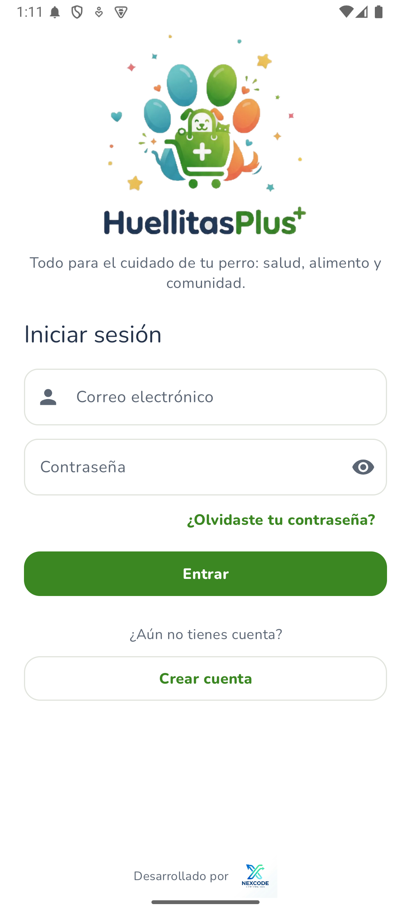
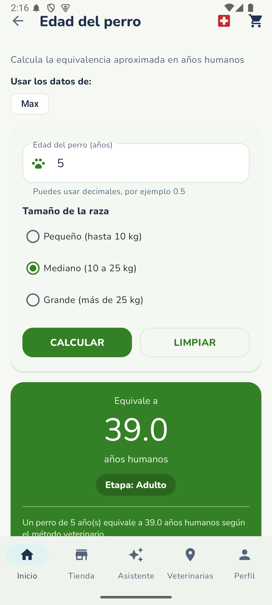
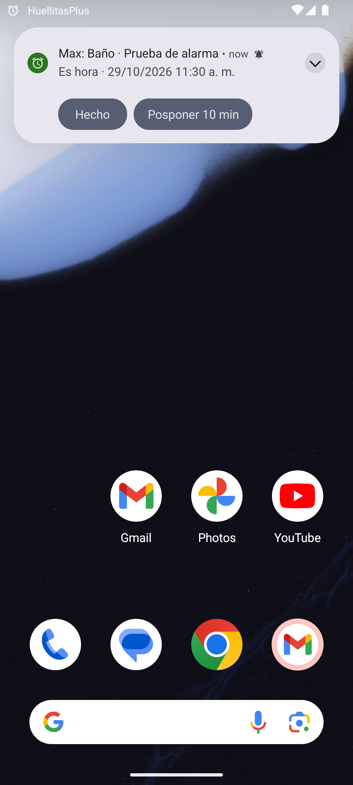
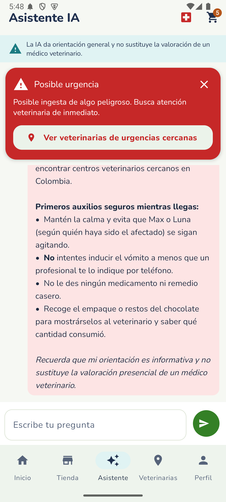
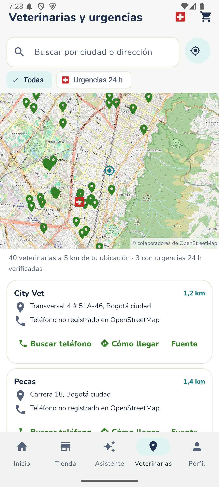
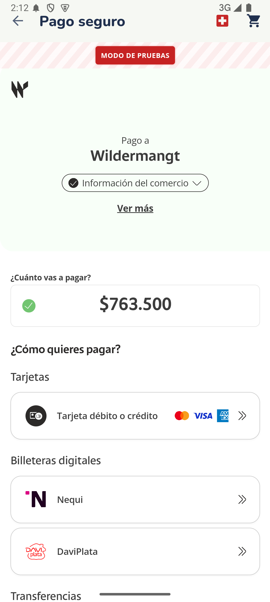
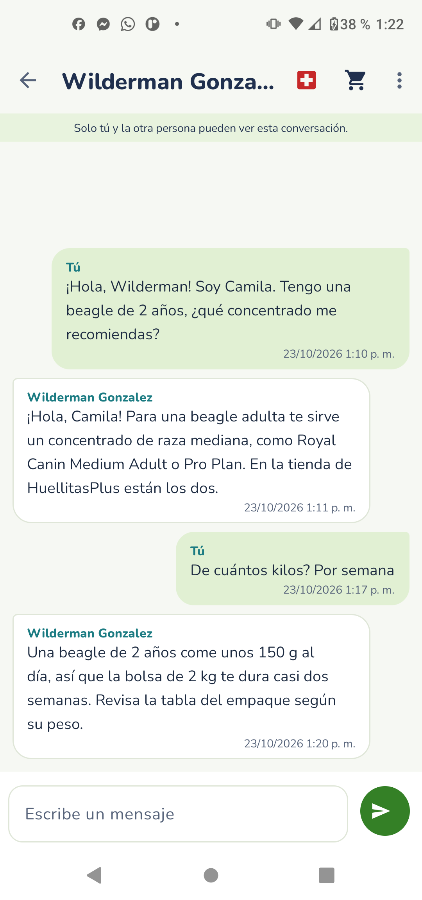

# HuellitasPlus — Manual de usuario

Guía rápida para usar la app (versión 2.0). La instalación y la configuración de los
servicios están en [`01_Configuracion_paso_a_paso.md`](01_Configuracion_paso_a_paso.md).

## 1. Instalar y entrar

1. Instala el APK de HuellitasPlus y ábrelo. Verás la intro con el logo.
2. Toca **Crear cuenta**: nombre, correo, ciudad, contraseña (mínimo 6 caracteres) y la
   autorización de tratamiento de datos (Ley 1581 de 2012).
3. Desde la siguiente vez, entra con tu correo y contraseña. Si la olvidaste, toca
   **¿Olvidaste tu contraseña?** y te llega un correo para cambiarla.

## 2. Mis perros y calculadora de edad

- En **Inicio → Edad del perro** escribe la edad en años y el tamaño (pequeño, mediano o
  grande) y toca **Calcular**. Verás la edad humana equivalente, la etapa de vida y
  recomendaciones.
- La app no deja calcular con el campo vacío, con números negativos ni con más de 30 años.
- En **Perfil → Mis perros** registras cada perro, con foto opcional: se elige de la galería
  y se recorta antes de guardarla.

## 3. Cuidados y alarmas

1. En **Inicio**, toca la tarjeta **Vacunas, medicinas y baños** y luego **+**. Elige el
   tipo (vacuna, desparasitante, medicamento, baño o corte de pelo), el perro, la fecha y la
   hora, y si quieres un aviso anticipado.
2. La primera vez, la app pide permiso para mostrar notificaciones.
3. A la hora programada suena la alarma con dos botones: **Hecho**, que lo marca como
   completado y lo guarda en el historial, y **Posponer 10 min**.
4. Las alarmas siguen funcionando aunque cierres la app o reinicies el teléfono.

## 4. Asistente con IA

- En **Asistente** pregunta sobre cuidado canino (alimentación, baño, comportamiento…).
  Responde en español y conoce los perros que registraste.
- Si describes una posible emergencia (por ejemplo, que comió chocolate y tiembla),
  aparece un **aviso rojo de urgencia** con un botón que abre el mapa de veterinarias
  24 horas.
- El asistente **no reemplaza al veterinario**: no da diagnósticos ni dosis.

## 5. Veterinarias

- **Veterinarias** muestra en el mapa las veterinarias reales cercanas (datos de
  OpenStreetMap). Puedes filtrar las de urgencias 24 h, llamar o pedir cómo llegar.
- Si no das permiso de ubicación, busca una ciudad, por ejemplo «Medellín».

## 6. Tienda, carrito y pago

1. En **Tienda** busca o filtra alimentos para perros y toca **Agregar al carrito**.
2. En el **carrito** ajusta las cantidades con − y +. El envío es gratis desde $150.000.
3. Toca **Continuar con la compra**, escribe la dirección y el teléfono de entrega y
   confirma el pedido.
4. Se abre el pago seguro de **Wompi**: tarjeta, Nequi, Daviplata, PSE o Bancolombia. En
   este proyecto funciona en **modo de pruebas**: no se cobra dinero real.
5. En **Perfil → Mis pedidos** ves el estado (Pagado, Pago rechazado o Pago pendiente) y
   puedes descargar el comprobante en PDF.

## 7. Mensajes

En **Perfil → Mensajes → Nuevo chat** eliges otro usuario registrado y conversan en tiempo
real. Solo ustedes dos pueden ver esa conversación.

## 8. Sin conexión

Si no hay internet aparece la barra **«Sin conexión»**. La tienda se sigue viendo desde lo
guardado en el teléfono y los cuidados y alarmas funcionan igual. El asistente, el mapa y
los pagos esperan a que vuelva la red, con un mensaje claro.

## Preguntas frecuentes

| Pregunta | Respuesta |
|---|---|
| ¿Dónde se guardan mis datos? | En Firebase (Google). Cada usuario solo puede ver y modificar sus propios datos |
| ¿La app guarda los datos de mi tarjeta? | No. El pago ocurre en la página de Wompi; la app nunca ve tu tarjeta |
| ¿Puedo usar el asistente para una emergencia? | Te ayuda a identificarla y te lleva al mapa de urgencias, pero siempre debes acudir a un veterinario |
